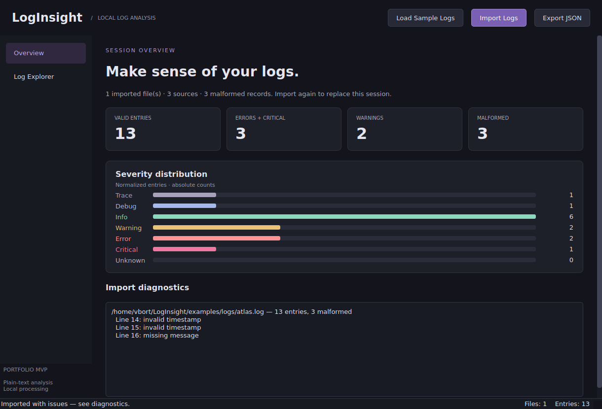
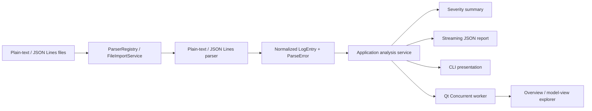

# LogInsight

A C++20 desktop and command-line tool for inspecting plain-text and JSON Lines logs.
Import files, compare severity counts, filter individual events, inspect original records,
and export a JSON report that includes malformed input. Processing stays on your machine.



*Actual Qt application, captured with the bundled dataset using an offscreen display.*
[View the full log explorer](docs/images/showcase-explorer.png) ·
[Inspect one service](docs/images/showcase-source-filter.png).

## Features

- `.log`, `.txt`, `.jsonl`, `.ndjson` and `.csv` ingestion with normalized timestamps, severities, sources and messages.
- Malformed records reported separately while valid records remain available.
- Dark Qt 6 interface with severity distribution and import diagnostics.
- Multi-file sessions, native file selection, drag-and-drop and one-click sample loading.
- Sortable table, message search, severity/source filters, UTC time ranges and raw-record details.
- Clickable session timeline with counts of events, errors and critical events per time bucket.
- Background import and export. Desktop imports show progress, support cancellation and enforce
  batch limits while the current session remains explorable.
- Configurable burst alerts link to the matching records in Log Explorer.
- Request and trace drill-down follows IDs across imported services.
- Visible-record JSON export includes active filters and source file paths.
- CLI summaries, documented exit codes and JSON export for automation.
- Qt-free core and application services, with an optional desktop build.

Desktop alerts evaluate a configurable burst rule over the imported session.
The alerts and storage libraries remain scaffolding.

## Quick start

Requirements: CMake 3.24+, a C++20 compiler with chrono calendar support, nlohmann/json,
and GoogleTest for tests. The desktop additionally needs Qt 6.4+ Widgets, Concurrent and Test.

On Ubuntu, install dependencies:

```sh
sudo apt-get update
sudo apt-get install build-essential cmake nlohmann-json3-dev libgtest-dev qt6-base-dev
```

From the repository root:

```sh
cmake -S . -B build -DCMAKE_BUILD_TYPE=Release \
  -DLOGINSIGHT_BUILD_GUI=ON -DLOGINSIGHT_FETCH_GTEST=OFF
cmake --build build --parallel 4
ctest --test-dir build --output-on-failure
./build/src/gui/loginsight-gui --sample
```

The sample is copied next to the executable, so **Load Sample Logs** also works when the
application starts from another directory. Keep the `samples/` directory alongside it.
The build tree is runnable; standalone binary packaging is not provided.

For CLI development without Qt:

```sh
cmake -S . -B build-headless -DCMAKE_BUILD_TYPE=Release \
  -DLOGINSIGHT_BUILD_GUI=OFF -DLOGINSIGHT_FETCH_GTEST=OFF
cmake --build build-headless --parallel 4
ctest --test-dir build-headless --output-on-failure
./build-headless/src/app/loginsight analyse examples/logs/atlas.log
```

`LOGINSIGHT_BUILD_TESTS=OFF` removes the GoogleTest requirement. If GoogleTest is absent,
`LOGINSIGHT_FETCH_GTEST=ON` permits fetching the pinned v1.15.2 tag. System development
packages keep normal builds offline after installation. No spdlog or SQLite dependency is needed.

Validated locally on Ubuntu 26.04, GCC 15.2, Qt 6.10.2. CI is configured for Ubuntu 24.04;
that workflow has not been executed as part of this local session. Windows and macOS have
not been verified.

## Usage

### Desktop

1. Click **Load Sample Logs**, or choose **Import Logs → Choose log files** to select one or several files.
2. Review counts, alerts and import diagnostics in **Overview**. Open **Recap** for the
   severity donut chart and the five sources with the most entries in the current session.
   Select a severity slice, legend button, or source bar to open matching logs.
3. Open **Log Explorer** or click a count on the overview. The **Malformed** count jumps to
   diagnostics. Search message text, select a severity or source, or click a column header to sort.
   Click a timeline bucket or open **Time range**, enter one or both UTC bounds, and select **Apply**.
   Both bounds are inclusive, and the time range combines with the other filters. Use
   the filter chips to remove individual filters, or **Clear all** to reset them. Select a row
   to inspect its message, input path and raw record in the resizable details pane.
   If it includes a request or trace ID, choose **Follow request** or **Follow trace**
   to see exact matches across all sources in chronological order. Remove the corresponding
   filter chip to exit the drill-down.
4. Select **Export full session** and choose a new destination. Export includes the entire session,
   regardless of table filters, along with failed-file diagnostics and malformed records. Use
   **Export filtered results (N)** in Log Explorer to save only matching rows in their current sort order,
   with the active filters and the source path for each record.

Each import replaces the current session; selecting multiple files creates one session.
A batch in which every file fails keeps the prior session. Empty or entirely malformed
files are valid imports with zero valid entries. Duplicate paths within one selection are
imported once. Diagnostics show up to 20 malformed-record reasons per file; JSON contains
all of them. While importing, select **Cancel import** to keep the previous session. Desktop
imports are limited to 128 files, 32 MiB of input per batch, 200,000 physical lines per batch
(including blank and malformed lines), and 256 KiB per line excluding LF.
Exceeding a limit keeps the previous session. Imports and exports must finish before closing the
window. These limits apply to the desktop.

### Burst alerts

In **Overview**, select an alert and choose **Open matching records**. The default rule flags
five `ERROR` or `CRITICAL` events from the same source within 60 seconds, including events
spread across multiple files. **Alert rule** lets you change the event count, window, minimum
severity, and optional exact source. Changes reevaluate the current session. The rule orders
records by timestamp and uses each matching record once. Settings last until the app closes.

### Command line

```sh
./build/src/app/loginsight --help
./build/src/app/loginsight analyse examples/logs/atlas.log
./build/src/app/loginsight analyse examples/logs/atlas.log --json /tmp/atlas-report.json
```

Choose an unused report path. Export refuses to overwrite existing files, including input
logs. It stages the report in the destination directory, then publishes it using an exclusive
hard link; the destination filesystem must support hard links. A failed write does not leave
a partially written destination. Output JSON uses schema version 1.

| Exit code | Meaning |
|---|---|
| 0 | Completed, possibly with malformed records |
| 64 | Invalid arguments |
| 65 | Unsupported format |
| 66 | Missing input file |
| 74 | Input/output or report failure |
| 78 | Application configuration failure |

### Example analysis

Actual output from the bundled fictional three-service session:

```text
Analysis complete

File: examples/logs/atlas.log
Valid entries: 13
Malformed lines: 3

Trace: 1
Debug: 1
Info: 6
Warning: 2
Error: 2
Critical: 1
Unknown: 0
```

The sample includes recovery,
latency warnings, synthetic service failures and deliberately malformed records.

## Supported formats and limits

One record per line:

```text
YYYY-MM-DD HH:MM:SS LEVEL SOURCE MESSAGE
2026-10-20 09:00:15 ERROR worker Synthetic database connection failed; retry scheduled
```

- Extensions are case-insensitive `.log` and `.txt`; detection uses the extension.
- Levels: TRACE, DEBUG, INFO, WARNING/WARN, ERROR, CRITICAL, case-insensitive.
- Timestamp separators can be a space or `T`; UTC `Z` suffix is not accepted by the
  plain-text record grammar. Zone-free timestamps are interpreted as UTC.
- Invalid dates, unsupported levels and missing fields are malformed records.
- Spaces/tabs separate fields. Empty/whitespace-only lines are ignored; LF and CRLF work.
- Plain-text timestamps have second precision. Multiline plain-text records are unsupported.
- Timestamps must fit the platform's `system_clock` range (roughly 1677–2262 on the validated system).
- UTF-8 is expected; desktop display and JSON export replace invalid UTF-8 sequences.
- Data and raw records stay in memory. The table uses a model/proxy rather than per-row widgets,
  but filtering/sorting still runs on the UI thread. This is not a streaming or unbounded-data tool.
  A 30,000-entry import is covered by a responsiveness regression test; no throughput benchmark is claimed.

### JSON Lines

Import a `.jsonl` or `.ndjson` file through the desktop or with `loginsight analyse <file>`.
Each nonblank line must be a JSON object. The default string fields are `timestamp`, `level`,
`source`, and `message`. Under **Import Logs → JSON field mappings**, use dots for nested paths, such
as `event.ts`, or leave the source mapping blank to use the filename stem. Mappings apply to
subsequent imports until the app closes. The CLI uses the default names.

```json
{"timestamp":"2026-10-20T09:00:15Z","level":"error","source":"worker","message":"Database connection failed"}
```

Timestamps accept a space or `T` separator, up to nine fractional digits, and either `Z`
or a numeric offset such as `+02:00`. Timestamps without an offset are interpreted as UTC.
The explorer and JSON reports display normalized UTC. Optional top-level string fields
`trace_id` and `request_id` enable correlation. Malformed lines retain the original text and
line number while valid records remain available.
Standalone `.json` files and JSON arrays are unsupported.

### CSV

Import comma-separated `.csv` files with a header. The default columns are `timestamp`,
`level`, `source`, and `message`, in any order. Use **Import Logs → CSV column mappings**,
or pass four column names after `--csv-columns` in the CLI:

```sh
loginsight analyse service.csv --csv-columns when severity service details
```

Leave the source mapping blank (pass `''` in the CLI) to use the filename stem. Quoted
commas and doubled quotes are supported. Records must each fit on a single physical line.
Timestamps accept the same format as JSON Lines.

## Architecture



| Layer | Responsibility |
|---|---|
| `src/core` | Value-based domain model and severity conversion; standard C++ only |
| `src/parsers` | Timestamp/record validation, parser registry, import results, summary calculation |
| `src/app` | Shared analysis/report service, separate CLI library and executable |
| `src/gui` | Qt presentation, immutable session indexing, asynchronous job coordination |
| `tests` | GoogleTest unit/integration cases and QtTest model/workflow tests |

### Technology and engineering decisions

- **C++20:** RAII, value semantics, `std::chrono`, `std::filesystem` and explicit result status.
- **Parser extensibility:** `ILogParser` owns format knowledge; the registry owns parsers with
  `unique_ptr`. Each import service borrows the registry for a bounded lifetime.
- **Normalization:** consumers use `LogEntry`, never parser-specific strings. Malformed records
  carry a line number, raw input and reason. A stream failure is an I/O failure rather than
  a successful truncated import.
- **Qt 6 Widgets/Concurrent:** workers construct immutable datasets. Watcher completion updates
  widgets/models on the UI thread. Export snapshots share the session without copying records.
  This follows Qt's [worker/watcher model](https://doc.qt.io/qt-6.8/qfuturewatcher.html).
- **nlohmann/json:** JSON Lines parsing and safe, versioned report serialization. Reports
  stream entries instead of constructing a duplicate document.
- **CMake:** target-based C++20 requirements, strict warnings, optional GUI/tests/sanitizers.
- **GoogleTest and QtTest:** parser, service, CLI and UI regressions; GUI tests run offscreen.

## Testing

```sh
ctest --test-dir build --output-on-failure

cmake -S . -B build-asan -DCMAKE_BUILD_TYPE=Debug \
  -DLOGINSIGHT_BUILD_GUI=ON -DLOGINSIGHT_FETCH_GTEST=OFF \
  -DLOGINSIGHT_ENABLE_SANITIZERS=ON
cmake --build build-asan --parallel 4
ctest --test-dir build-asan --output-on-failure
```

The desktop CTest case sets `QT_QPA_PLATFORM=offscreen`. It checks model integrity, filtering,
sorting, selection/raw details, asynchronous import/export, sample loading, mixed input,
failed-import preservation, busy-close handling and a larger import. ASan/UBSan are enabled
for supported GCC/Clang builds. See [validation evidence](docs/PORTFOLIO_RELEASE_PLAN.md)
for actual results and environmental restrictions.

To regenerate genuine screenshots from the GUI tests (GUI build required):

```sh
mkdir -p docs/images
QT_QPA_PLATFORM=offscreen LOGINSIGHT_CAPTURE_DIR="$PWD/docs/images" \
  ./build/tests/gui/loginsight_gui_tests
```

## Portfolio description

LogInsight demonstrates an end-to-end C++20 log-processing application: extensible parsers
normalize input into domain values, shared application services calculate severity summaries
and serialize reports, and a Qt desktop interface and CLI expose the same pipeline. The
project emphasizes explicit failures, ownership, regression testing and reproducible demos.

## Roadmap

- Explore streaming ingestion and paged browsing for sessions beyond the desktop limits.
- Validate native desktop packaging and accessibility on additional platforms.

## License

No `LICENSE` file is present and no license has been selected. This repository currently
grants no explicit open-source license. The author must choose one before an open-source
release. See the [release notes](docs/RELEASE_NOTES.md) for release readiness and limitations.
