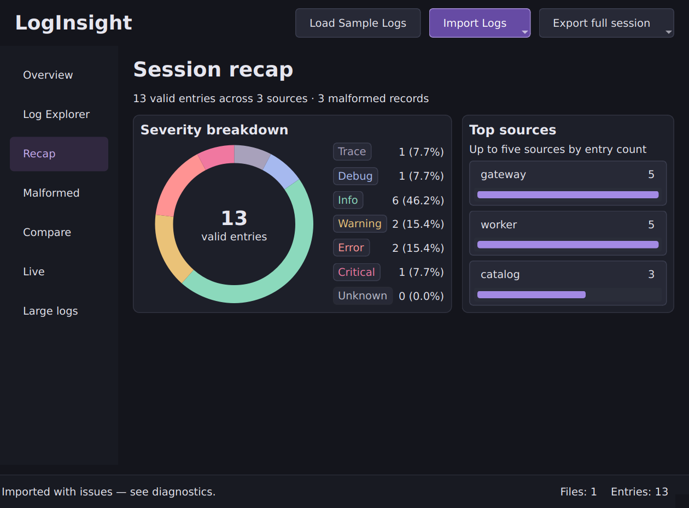
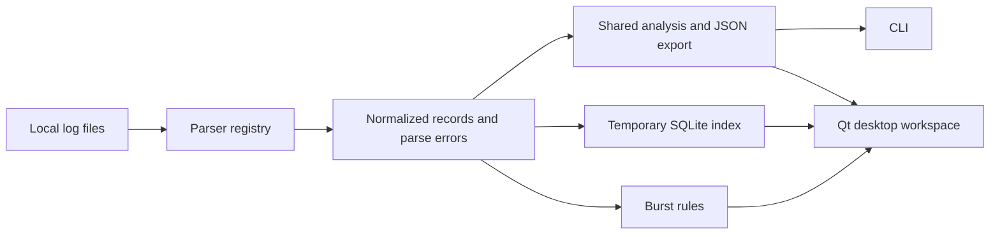

# LogInsight

LogInsight is a local log investigation tool with a Qt 6 desktop app and a C++20 command-line interface. Import logs from several services, find errors in a time window, follow a request across sources, and export the records you need. Logs are processed on your machine.



## Quick start

On Ubuntu 24.04, install a C++20 toolchain, CMake, Qt Widgets and Concurrent, SQLite, nlohmann/json, and GoogleTest:

```sh
sudo apt update
sudo apt install build-essential cmake nlohmann-json3-dev libgtest-dev qt6-base-dev libsqlite3-dev
```

From the repository root, build and launch the desktop app. Keep the generated `samples/` directory alongside the GUI executable.

```sh
cmake -S . -B build -DCMAKE_BUILD_TYPE=Release \
  -DLOGINSIGHT_BUILD_GUI=ON -DLOGINSIGHT_FETCH_GTEST=OFF
cmake --build build --parallel 4
./build/src/gui/loginsight-gui --sample
```

The bundled [Atlas demo](examples/logs/atlas.log) has **13 valid records, 3 malformed records, and 3 sources**. Open **Recap** and click the **worker** source bar to see its five matching records. Omit `--sample` to start with an empty session.

### Headless build

The CLI does not require Qt or SQLite. Install the compiler, CMake 3.24 or later, nlohmann/json, and GoogleTest, then run:

```sh
cmake -S . -B build-headless -DCMAKE_BUILD_TYPE=Release \
  -DLOGINSIGHT_BUILD_GUI=OFF -DLOGINSIGHT_FETCH_GTEST=OFF
cmake --build build-headless --parallel 4
./build-headless/src/app/loginsight analyse examples/logs/atlas.log
```

If GoogleTest is unavailable, configure with `-DLOGINSIGHT_FETCH_GTEST=ON` to fetch the pinned version when needed. To build without tests, set `-DLOGINSIGHT_BUILD_TESTS=OFF`.

## Desktop workflow

| View | What you can do |
| --- | --- |
| **Overview** | Review severity counts, import diagnostics, and burst alerts. Configure up to 16 named rules with their own threshold, window, minimum severity, and source. |
| **Log Explorer** | Search and sort records, combine severity, source, and time filters, inspect original lines, and follow exact `trace_id` or `request_id` matches. Save named filters across restarts and bookmark records for the current session. |
| **Recap** | See severity proportions and the five highest-volume sources. Click a slice, severity label, or source bar to open the matching records. |
| **Malformed** | Filter rejected lines by file or reason and copy the original text. |
| **Compare** | Pin the current session as a baseline, import another batch, and compare counts by severity and source. The baseline is kept until the app closes. |
| **Live** | Follow new complete lines in a local file. The view keeps the latest 5,000 lines, clips very long lines, and handles truncation and file replacement on Unix. |
| **Large logs** | Build a temporary SQLite index and browse 200 records per page in file order, including original text on selection. Malformed rows are counted and skipped in this mode. |

Use **Import Logs → Choose log files**, or drop files onto the window. Each successful batch replaces the regular session. The previous session stays open if you cancel, exceed a limit, or if none of the selected files can be imported. Regular imports allow up to 128 files, 32 MiB per batch, 200,000 physical lines, and 256 KiB per line. **Large logs** bypasses the regular batch limits and keeps the per-line cap. Its index needs free disk space and is removed when replaced or on a normal exit. For filters, alerts, charts, and JSON export, use a regular import.

Choose **Export full session** for all files and diagnostics, or **Export filtered results** to save visible records in table order with the active filters. Either menu offers **Redact and preview**. Enter exact case-sensitive values to mask, one per line. Redacted reports omit raw record text, including rejected lines. The preview is limited to the first 16 KiB. Review the saved report before sharing.

## Input formats

| Format | Expected records |
| --- | --- |
| Plain text (`.log`, `.txt`) | One `YYYY-MM-DD HH:MM:SS LEVEL SOURCE MESSAGE` event per line. Timestamps use UTC at second precision. |
| JSON Lines (`.jsonl`, `.ndjson`) | One object per line with string fields `timestamp`, `level`, `source`, and `message` by default. Use **Import Logs → JSON field mappings** to change paths, including nested fields such as `event.ts`. |
| CSV (`.csv`) | Comma-separated rows with a header, one physical line per record. Default headers are `timestamp`, `level`, `source`, and `message`, in any order. Quoted commas and doubled quotes are supported. |

JSON Lines and CSV accept fractional seconds and numeric timezone offsets. The app normalizes timestamps to UTC. Desktop JSON and CSV mappings apply to subsequent imports until the app closes. Leave the source mapping blank to use the filename stem. See [log format details](docs/log-format.md) for the normalized data model.

## CLI examples

```sh
./build/src/app/loginsight --help
./build/src/app/loginsight analyse examples/logs/atlas.log
./build/src/app/loginsight analyse examples/logs/atlas.log --json /tmp/atlas-report.json
./build/src/app/loginsight analyse tests/fixtures/csv_mapped.csv \
  --csv-columns when severity service details
```

The CLI uses default JSON Lines fields. For a CSV without a source column, pass an empty third mapping argument. Use a new path for JSON reports. Publishing a report requires hard-link support in the destination directory and never overwrites an existing file.

Exit codes are `0` for completed analysis (including malformed records), `64` for invalid arguments, `65` for unsupported format, `66` for missing input, `74` for I/O or report failure, and `78` for application configuration failure.

## Architecture and tests



The [core](src/core), [parsers](src/parsers), [rules](src/rules), and [application services](src/app) are independent of Qt. The [desktop](src/gui) builds regular imports in a worker and shares immutable session data with its views. Large-log mode streams valid records into an index instead of keeping the whole batch in memory.

```sh
ctest --test-dir build --output-on-failure
ctest --test-dir build-headless --output-on-failure
```

The desktop workflow tests run offscreen. [CI](.github/workflows/ci.yml) defines desktop, headless, and sanitizer builds on Ubuntu 24.04. Use `-DLOGINSIGHT_ENABLE_SANITIZERS=ON` for supported GCC or Clang builds.

## Distribution and license

The build tree is runnable. Installers and native Windows or macOS builds have not been validated. The repository does not currently include a license file.
