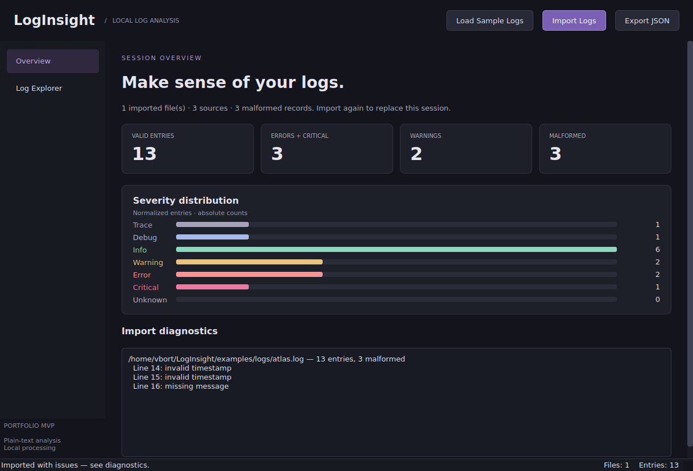
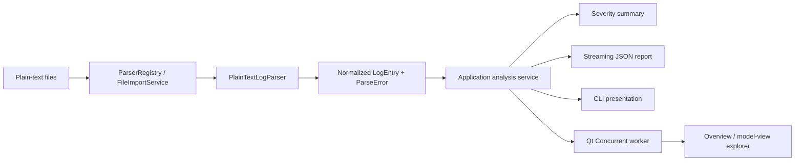

# LogInsight

A C++20 desktop and command-line tool for inspecting structured plain-text logs.
Import files, compare severity counts, filter individual events, inspect original records,
and export a JSON report that includes malformed input. Processing stays on your machine.



*Actual Qt application, captured with the bundled dataset using an offscreen display.*
[View the full log explorer](docs/images/showcase-explorer.png) ·
[Inspect one service](docs/images/showcase-source-filter.png).

## Features

- `.log` and `.txt` ingestion with normalized timestamps, severities, sources and messages.
- Malformed records reported separately while valid records remain available.
- Dark Qt 6 interface with severity distribution and import diagnostics.
- Multi-file sessions, native file selection, drag-and-drop and one-click sample loading.
- Sortable table, message search, severity/source filters and raw-record details.
- Background import and export; the current session remains explorable during processing.
- CLI summaries, documented exit codes and JSON export for automation.
- Qt-free core and application services, with an optional desktop build.

There is no rule engine or generated alert system in this release. Rules, alerts and storage
modules are scaffolding; JSON configuration validation exists without a JSON input parser.

## Quick start

Requirements: CMake 3.24+, a C++20 compiler with chrono calendar support, nlohmann/json,
and GoogleTest for tests. The desktop additionally needs Qt 6.4+ Widgets, Concurrent and Test.

On Ubuntu, install dependencies:

```sh
sudo apt-get update
sudo apt-get install build-essential cmake nlohmann-json3-dev libgtest-dev qt6-base-dev
```

From the repository root:

```sh
cmake -S . -B build -DCMAKE_BUILD_TYPE=Release \
  -DLOGINSIGHT_BUILD_GUI=ON -DLOGINSIGHT_FETCH_GTEST=OFF
cmake --build build --parallel 4
ctest --test-dir build --output-on-failure
./build/src/gui/loginsight-gui --sample
```

The sample is copied next to the executable, so **Load Sample Logs** also works when the
application starts from another directory. Keep the `samples/` directory alongside it.
The build tree is runnable; standalone binary packaging is not provided.

For CLI development without Qt:

```sh
cmake -S . -B build-headless -DCMAKE_BUILD_TYPE=Release \
  -DLOGINSIGHT_BUILD_GUI=OFF -DLOGINSIGHT_FETCH_GTEST=OFF
cmake --build build-headless --parallel 4
ctest --test-dir build-headless --output-on-failure
./build-headless/src/app/loginsight analyse examples/logs/atlas.log
```

`LOGINSIGHT_BUILD_TESTS=OFF` removes the GoogleTest requirement. If GoogleTest is absent,
`LOGINSIGHT_FETCH_GTEST=ON` permits fetching the pinned v1.15.2 tag. System development
packages keep normal builds offline after installation. No spdlog or SQLite dependency is needed.

Validated locally on Ubuntu 26.04, GCC 15.2, Qt 6.10.2. CI is configured for Ubuntu 24.04;
that workflow has not been executed as part of this local session. Windows and macOS have
not been verified.

## Usage

### Desktop

1. Click **Load Sample Logs**, or **Import Logs** to select one or several files.
2. Review valid-entry counts, severity distribution and malformed-record diagnostics.
3. Open **Log Explorer**. Search message text, select a severity/source, or click a column
   header to sort. Select a row to inspect its message, input path and raw record.
4. Select **Export JSON** and choose a new destination. Export includes the entire session,
   regardless of table filters, along with failed-file diagnostics and malformed records.

Each import replaces the current session; selecting multiple files creates one session.
A batch in which every file fails keeps the prior session. Empty or entirely malformed
files are valid imports with zero valid entries. Duplicate paths within one selection are
imported once. Diagnostics show up to 20 malformed-record reasons per file; JSON contains
all of them. Imports/exports must finish before closing the window; cancellation is future work.

### Command line

```sh
./build/src/app/loginsight --help
./build/src/app/loginsight analyse examples/logs/atlas.log
./build/src/app/loginsight analyse examples/logs/atlas.log --json /tmp/atlas-report.json
```

Choose an unused report path. Export refuses to overwrite existing files, including input
logs. It stages the report in the destination directory, then publishes it using an exclusive
hard link; the destination filesystem must support hard links. A failed write does not leave
a partially written destination. Output JSON uses schema version 1.

| Exit code | Meaning |
|---|---|
| 0 | Completed, possibly with malformed records |
| 64 | Invalid arguments |
| 65 | Unsupported format |
| 66 | Missing input file |
| 74 | Input/output or report failure |
| 78 | Application configuration failure |

### Example analysis

Actual output from the bundled fictional three-service session:

```text
Analysis complete

File: examples/logs/atlas.log
Valid entries: 13
Malformed lines: 3

Trace: 1
Debug: 1
Info: 6
Warning: 2
Error: 2
Critical: 1
Unknown: 0
```

These are event severity counts, not detection-rule alerts. The sample includes recovery,
latency warnings, synthetic service failures and deliberately malformed records.

## Supported formats and limits

One record per line:

```text
YYYY-MM-DD HH:MM:SS LEVEL SOURCE MESSAGE
2026-10-20 09:00:15 ERROR worker Synthetic database connection failed; retry scheduled
```

- Extensions are case-insensitive `.log` and `.txt`; detection uses the extension.
- Levels: TRACE, DEBUG, INFO, WARNING/WARN, ERROR, CRITICAL, case-insensitive.
- Timestamp separators can be a space or `T`; UTC `Z` suffix is not accepted by the
  plain-text record grammar. Zone-free timestamps are interpreted as UTC.
- Invalid dates, unsupported levels and missing fields are malformed records.
- Spaces/tabs separate fields. Empty/whitespace-only lines are ignored; LF and CRLF work.
- Fractional seconds, timezone offsets, multiline events, CSV, JSON and JSON Lines are unsupported.
- Timestamps must fit the platform's `system_clock` range (roughly 1677–2262 on the validated system).
- UTF-8 is expected; desktop display and JSON export replace invalid UTF-8 sequences.
- Data and raw records stay in memory. The table uses a model/proxy rather than per-row widgets,
  but filtering/sorting still runs on the UI thread. This is not a streaming or unbounded-data tool.
  A 30,000-entry import is covered by a responsiveness regression test; no throughput benchmark is claimed.

## Architecture



| Layer | Responsibility |
|---|---|
| `src/core` | Value-based domain model and severity conversion; standard C++ only |
| `src/parsers` | Timestamp/record validation, parser registry, import results, summary calculation |
| `src/app` | Shared analysis/report service, separate CLI library and executable |
| `src/gui` | Qt presentation, immutable session indexing, asynchronous job coordination |
| `tests` | GoogleTest unit/integration cases and QtTest model/workflow tests |

### Technology and engineering decisions

- **C++20:** RAII, value semantics, `std::chrono`, `std::filesystem` and explicit result status.
- **Parser extensibility:** `ILogParser` owns format knowledge; the registry owns parsers with
  `unique_ptr`. Each import service borrows the registry for a bounded lifetime.
- **Normalization:** consumers use `LogEntry`, never parser-specific strings. Malformed records
  carry a line number, raw input and reason. A stream failure is an I/O failure rather than
  a successful truncated import.
- **Qt 6 Widgets/Concurrent:** workers construct immutable datasets. Watcher completion updates
  widgets/models on the UI thread. Export snapshots share the session without copying records.
  This follows Qt's [worker/watcher model](https://doc.qt.io/qt-6.8/qfuturewatcher.html).
- **nlohmann/json:** safe JSON escaping and versioned report serialization, confined to the
  application implementation. Reports stream entries instead of constructing a duplicate document.
- **CMake:** target-based C++20 requirements, strict warnings, optional GUI/tests/sanitizers.
- **GoogleTest and QtTest:** parser, service, CLI and UI regressions; GUI tests run offscreen.

## Testing

```sh
ctest --test-dir build --output-on-failure

cmake -S . -B build-asan -DCMAKE_BUILD_TYPE=Debug \
  -DLOGINSIGHT_BUILD_GUI=ON -DLOGINSIGHT_FETCH_GTEST=OFF \
  -DLOGINSIGHT_ENABLE_SANITIZERS=ON
cmake --build build-asan --parallel 4
ctest --test-dir build-asan --output-on-failure
```

The desktop CTest case sets `QT_QPA_PLATFORM=offscreen`. It checks model integrity, filtering,
sorting, selection/raw details, asynchronous import/export, sample loading, mixed input,
failed-import preservation, busy-close handling and a larger import. ASan/UBSan are enabled
for supported GCC/Clang builds. See [validation evidence](docs/PORTFOLIO_RELEASE_PLAN.md)
for actual results and environmental restrictions.

To regenerate genuine screenshots from the GUI tests (GUI build required):

```sh
mkdir -p docs/images
QT_QPA_PLATFORM=offscreen LOGINSIGHT_CAPTURE_DIR="$PWD/docs/images" \
  ./build/tests/gui/loginsight_gui_tests
```

## Portfolio description

LogInsight demonstrates an end-to-end C++20 log-processing application: extensible parsers
normalize input into domain values, shared application services calculate severity summaries
and serialize reports, and a Qt desktop interface and CLI expose the same pipeline. The
project emphasizes explicit failures, ownership, regression testing and reproducible demos.

## Roadmap

- Add JSON Lines ingestion using the existing configuration model.
- Add a small, tested rule engine before exposing an alerts screen.
- Add cancellation and bounded/streaming ingestion for larger datasets.
- Validate native desktop packaging and accessibility on additional platforms.

## License

No `LICENSE` file is present and no license has been selected. This repository currently
grants no explicit open-source license. The author must choose one before an open-source
release. See the [release notes](docs/RELEASE_NOTES.md) for release readiness and limitations.
